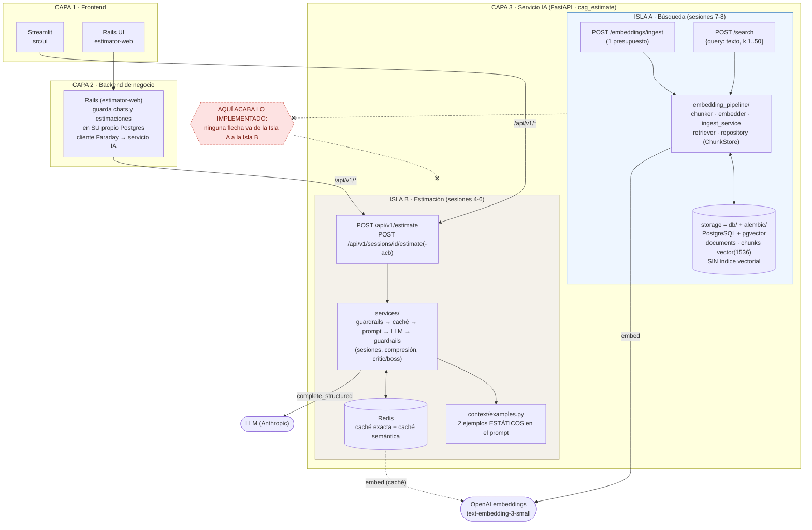
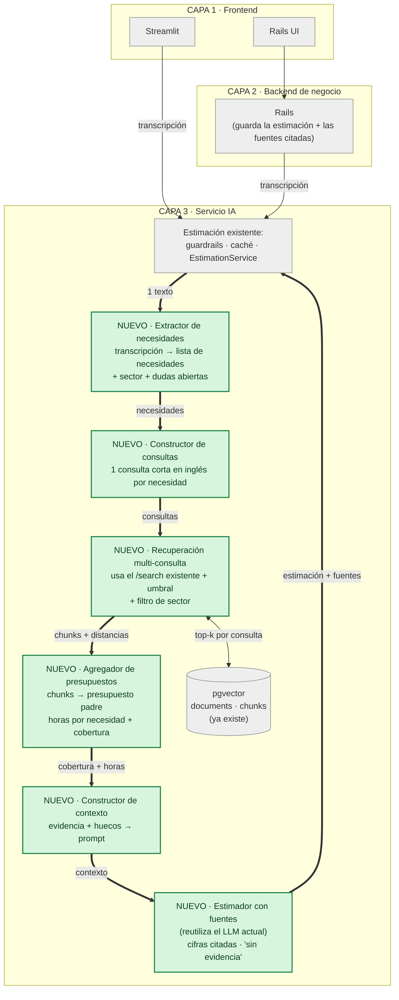

# Diagnóstico arquitectónico — Sesión 09 (pre-work)

**En una frase:** hoy el sistema sabe guardar presupuestos históricos y buscar los más parecidos a un texto, y por separado sabe generar una estimación con un LLM, pero **las dos mitades no están conectadas**. Todo lo de abajo sale de ejecutar el sistema real el 2026-11-01 (15 presupuestos, 52 chunks en pgvector) con la transcripción `02_ambiguous.txt`.

---

## 1. Diagrama de la arquitectura actual

**Cómo leerlo:** las flechas continuas son llamadas que existen hoy. El recuadro rojo punteado marca dónde acaba lo implementado: la búsqueda (izquierda) y la estimación (derecha) son dos islas que **no se tocan**.



**Nombres del ejercicio frente a nuestras carpetas** (no hay `ingest/` ni `storage/` literales):

| Ejercicio | En nuestro repo |
|---|---|
| `ingest/` | `embedding_pipeline/ingest_service.py` + `router.py` (`POST /embeddings/ingest`) y `chunker.py` |
| `embedding_pipeline/` | `embedding_pipeline/` (`embedder.py`, `retriever.py`, `search_router.py`) |
| `storage/` | `db/` (modelos, sesión async) + `alembic/` + `embedding_pipeline/repository.py` |

---

## 2. Trace anotado de `02_ambiguous.txt`

La transcripción es de Rubén Castaño (tienda gourmet "Casa Castaño"), en español, 506 palabras. Pide, entre muchas frases de relleno: **vender por internet**, **puntos de fidelidad**, un **panel de control** (pedidos, stock, gráficas), **pago con tarjeta** y un **correo de confirmación**; y termina con "decidme un número".

Prerrequisito: stack levantado (`docker compose ps` → `api` y `estimator-pgvector` healthy) y el corpus cargado:

```bash
cd cag-estimate            # carpeta del proyecto (la que tiene docker-compose.yml)
docker compose exec -T pgvector psql -U estimator -d estimator -tc \
  "select (select count(*) from documents), (select count(*) from chunks)"
#  15 |   52
```

El servicio no tiene ningún endpoint que devuelva un vector, así que el script cliente `examples/trace_s09.py` (solo cliente, no cambia el servicio) llama a OpenAI directamente para el paso 1 y a `POST /search` para el paso 2:

```bash
PYTHONPATH=src uv run python ../examples/trace_s09.py ../examples/transcripts/02_ambiguous.txt
```

### Paso 1 — Embeber la transcripción completa

Salida real:

```text
input: 2854 characters, 506 words
== STEP 1: embedding ==
model=text-embedding-3-small dimensions=1536 l2_norm=0.999691
first 5: [0.006233, 0.029297, -0.031525, -0.034607, 0.002199]
last  5: [0.058136, 0.024963, -0.00351, 0.030838, 0.019012]
```

**Comentario:** 1536 dimensiones y norma ≈ 1 (el modelo normaliza), así que comparar por coseno es comparar por ángulo. Es **un solo vector** que mezcla todo lo que dijo Rubén (tienda, tienda física de su padre, fidelización, panel, pago, correo, Francia…): es una "media" de temas, no una lista de necesidades.

### Paso 2 — Búsqueda semántica (top-5)

```bash
curl -s -X POST http://localhost:8000/search \
  -H "Content-Type: application/json" \
  -d "$(python3 -c 'import json,sys; print(json.dumps({"query": open("../examples/transcripts/02_ambiguous.txt").read(), "k": 5}))')"
```

Respuesta cruda (el campo `query` repite la transcripción entera; lo abrevio con `...` y dejo el resto tal cual):

```json
{
  "query": "Reunión exploratoria — sin título claro todavía\nCliente: Rubén Castaño ... Tranquilo, Rubén, lo recogemos y te volvemos con una propuesta. Gracias.",
  "k": 5,
  "search_time_ms": 1553,
  "results": [
    {
      "chunk_id": 32, "document_id": 9, "chunk_type": "budget_component",
      "content": "[Project: Headless e-commerce storefront with personalized recommendations]\n[Client sector: ecommerce | Year: 2024 | Main tech: node]\n\nComponent: Product catalog API\nDescription: GraphQL catalog API with faceted search, inventory availability and multi-currency pricing backed by Elasticsearch.\nTech stack: node, graphql, elasticsearch\nComplexity: medium\nEstimated hours: 150",
      "distance": 0.6104632897869019,
      "metadata": {"year": 2024, "budget_id": "BUD-2024-005", "complexity": "medium", "component_id": "CATALOG-001", "client_sector": "ecommerce", "estimated_hours": 150, "main_technology": "node"}
    },
    {
      "chunk_id": 33, "document_id": 9, "chunk_type": "budget_component",
      "content": "[Project: Headless e-commerce storefront ...]\n[Client sector: ecommerce | Year: 2024 | Main tech: node]\n\nComponent: Cart and checkout service\nDescription: Stateless cart service with promotion engine, tax calculation and a checkout orchestration that integrates the payment provider.\nTech stack: node, redis, postgresql\nComplexity: high\nEstimated hours: 140",
      "distance": 0.6158779369380458,
      "metadata": {"year": 2024, "budget_id": "BUD-2024-005", "complexity": "high", "component_id": "CART-002", "client_sector": "ecommerce", "estimated_hours": 140, "main_technology": "node"}
    },
    {
      "chunk_id": 34, "document_id": 9, "chunk_type": "budget_component",
      "content": "[Project: Headless e-commerce storefront ...]\n...\n\nComponent: Personalized recommendations\nDescription: Collaborative-filtering recommendations served from a feature store and exposed as a low-latency API for product and cart pages.\nTech stack: node, redis\nComplexity: medium\nEstimated hours: 110",
      "distance": 0.6395544967356124,
      "metadata": {"year": 2024, "budget_id": "BUD-2024-005", "complexity": "medium", "component_id": "RECO-003", "client_sector": "ecommerce", "estimated_hours": 110, "main_technology": "node"}
    },
    {
      "chunk_id": 35, "document_id": 9, "chunk_type": "budget_component",
      "content": "[Project: Headless e-commerce storefront ...]\n...\n\nComponent: Storefront PWA\nDescription: Progressive web app storefront consuming the headless APIs with server-side rendering for SEO.\nTech stack: next_js, react\nComplexity: low\nEstimated hours: 60",
      "distance": 0.6404933645552009,
      "metadata": {"year": 2024, "budget_id": "BUD-2024-005", "complexity": "low", "component_id": "STORE-004", "client_sector": "ecommerce", "estimated_hours": 60, "main_technology": "node"}
    },
    {
      "chunk_id": 43, "document_id": 12, "chunk_type": "budget_component",
      "content": "[Project: Fashion returns management and resale portal]\n[Client sector: ecommerce | Year: 2023 | Main tech: dotnet]\n\nComponent: Returns portal\nDescription: Self-service returns portal with label generation, reason capture and automatic restock or resale routing.\nTech stack: dotnet, sqlserver\nComplexity: medium\nEstimated hours: 140",
      "distance": 0.6432176696260352,
      "metadata": {"year": 2023, "budget_id": "BUD-2024-008", "complexity": "medium", "component_id": "RET-001", "client_sector": "ecommerce", "estimated_hours": 140, "main_technology": "dotnet"}
    }
  ]
}
```

**Comentario:** la búsqueda funciona a nivel de sector (los 5 son `ecommerce`), pero las 5 distancias están en un rango muy estrecho, de 0.6105 a 0.6432 (diferencia de 0.033), y **4 de los 5 chunks son del mismo presupuesto** (`BUD-2024-005`). La primera llamada tardó 1553 ms (arranque en frío); las siguientes, unos 220 ms.

### Paso 3 — Lectura de los chunks devueltos

| # | Chunk | Presupuesto | Sector | Distancia | ¿Relevante para Rubén? |
|---|---|---|---|---|---|
| 1 | `CATALOG-001` Product catalog API (150 h) | BUD-2024-005 | ecommerce | 0.6105 | **Sí**: necesita ver y vender productos por internet. |
| 2 | `CART-002` Cart and checkout service (140 h) | BUD-2024-005 | ecommerce | 0.6159 | **Sí**: carrito y checkout que integra el proveedor de pago (su "pago con tarjeta"). |
| 3 | `RECO-003` Personalized recommendations (110 h) | BUD-2024-005 | ecommerce | 0.6396 | **Poco**: él pidió puntos/club de fidelidad, no recomendaciones; solo se parecen en "fidelizar". |
| 4 | `STORE-004` Storefront PWA (60 h) | BUD-2024-005 | ecommerce | 0.6405 | **Sí, en parte**: es la tienda web, pero no dice nada de panel ni de pagos. |
| 5 | `RET-001` Returns portal (140 h) | BUD-2024-008 | ecommerce | 0.6432 | **No**: Rubén nunca habló de devoluciones. |

Resultado honesto: **2 de 5 claramente útiles, 1 a medias, 2 que sobran**. Y faltan tres cosas que el cliente dijo con énfasis: el **panel de control**, el **pago con tarjeta** (solo aparece tangencialmente dentro del checkout) y el **correo de confirmación**. Ver el fallo 1.

### Pruebas extra (solo llamadas de cliente) que sostienen el diagnóstico

Mismos comandos, cambiando la entrada (`--text "..."` en lugar del fichero):

| Consulta | Mejor distancia | Qué devuelve |
|---|---|---|
| Transcripción completa `02_ambiguous` (k=5) | 0.6105 (5.ª: 0.6432) | 4 chunks de un mismo presupuesto; faltan panel, pago y correo |
| Transcripción completa, **k=15** | 0.6105 … 0.6911 | A partir del 7.º entra gente de otros sectores: `healthcare` Inventory and reorder (0.6666), `industrial` Load forecasting (0.6700), `healthcare` Telemedicine video sessions (0.6834) |
| Consulta corta en inglés con las 5 necesidades | 0.4755 | `ecommerce` Cart and checkout, Product catalog, Real-time inventory sync |
| La misma idea corta **en español** | 0.6182 | Mismos presupuestos de `ecommerce`, distancias ≈ +0.14 |
| Una consulta por necesidad: `card payments checkout` | 0.5598 | `finance` **Payment gateway core** (0.5615, 220 h) |
| `sales dashboard with orders, stock and charts` | 0.5777 | `finance` **Merchant dashboard** (60 h) |
| `order confirmation email notification` | 0.6869 | `finance` **Push and email notifications** (60 h) |
| `loyalty points program` | 0.7367 | `ecommerce` Resale listing sync: **no hay nada de fidelización en el corpus** |
| `01_clear.txt` (clara) | 0.4212 … 0.4877 | 5 chunks de `finance`, casi todos del presupuesto BUD-2024-001 (OAuth, PSD2): aquí el retriever lo hace muy bien |
| `03_hard.txt` (difícil) | 0.5210 … 0.6185 | 5 chunks de `healthcare` (telemedicina, citas, FHIR…): trae las tres opciones que el cliente dudaba, sin distinguirlas |

Lectura: con una transcripción **clara** (01) el retriever funciona (distancias 0.42–0.49, sector correcto). El problema no es el motor de búsqueda en sí, sino lo que le damos y lo que hacemos con lo que devuelve.

---

## 3. Diagnóstico: cinco fallos identificados

### Fallo 1 — Un solo vector para muchas necesidades: lo importante queda fuera del top-5
- **Problema observado:** con la transcripción entera, el top-5 (y el top-15) no trae ni `Payment gateway core`, ni `Merchant dashboard` (aparece en el puesto 8, a 0.6684, por detrás de un chunk de `healthcare`), ni `Push and email notifications` (no entra en los 15). Con **una consulta por necesidad** sí aparecen: pago 0.5615, panel 0.5777, correo 0.6869. Rubén pidió esas tres cosas con énfasis ("fundamental", "clarísimo").
- **Causa probable:** la transcripción se convierte en un único embedding, una media de varios temas; el tema más "gordo" (tienda online) tapa a los demás. El sistema no tiene ninguna etapa que separe qué necesidades hay.
- **Propuesta de solución:** una etapa antes de buscar que **extraiga las necesidades** de la transcripción y lance **una búsqueda por necesidad**, para después unir los resultados.

### Fallo 2 — Consulta en español y con ruido contra un corpus en inglés: las distancias se desplazan y se comprimen
- **Problema observado:** las 5 distancias del trace van de 0.6105 a 0.6432 (rango 0.033); con la consulta corta en inglés van de 0.4755 a 0.5499 (rango 0.074). La misma idea corta escrita **en español** da 0.6182 de mejor distancia, es decir, ≈ +0.14 respecto al inglés. La transcripción completa queda en 0.6105, casi igual que esa consulta corta en español. Con `01_clear` (también en español) el mejor es 0.4212: la claridad del cliente también mueve la distancia.
- **Causa probable:** el corpus son chunks en inglés con cabecera técnica (`[Project: ...]`), y la consulta es lenguaje hablado en español con muletillas. El motor funciona entre idiomas, pero la **distancia no significa lo mismo** según el idioma y la claridad de la entrada. (Nota de honestidad: la comparación español/inglés no es un experimento controlado; la consulta en español usa palabras distintas de la inglesa. El orden de resultados sí se mantuvo.)
- **Propuesta de solución:** una pieza que **reformule la necesidad en el registro del corpus** (inglés técnico, una frase corta por necesidad) antes de embeber.

### Fallo 3 — No hay forma de decir "no tengo evidencia": siempre devuelve algo
- **Problema observado:** `loyalty points program` devuelve igualmente 3 chunks (mejor distancia 0.7367, `Resale listing sync`) aunque en el corpus **no existe nada de fidelización**. En el k=15 de la transcripción, `Telemedicine video sessions` (healthcare) queda a 0.6834, solo 0.07 peor que el mejor resultado útil (0.6105). Nada marca la diferencia entre "buen resultado" y "lo menos malo que había".
- **Causa probable:** `/search` hace un top-k por distancia sin umbral ni filtro (`ChunkStore.search`: `ORDER BY ... LIMIT k`), y devuelve la distancia cruda, que como se ve en el fallo 2 no es comparable entre consultas.
- **Propuesta de solución:** un **umbral de similitud y una señal de cobertura por necesidad** ("cubierta / débil / sin evidencia"), de modo que la estimación pueda decir "esto no lo sé" en vez de inventarlo.

### Fallo 4 — Chunks por componente: el top-k se queda en un solo presupuesto y no se puede sumar a una estimación
- **Problema observado:** 4 de los 5 resultados son del mismo presupuesto (`BUD-2024-005`). Sumar las horas del top-5 daría 150+140+110+60+140 = **600 h**, una cifra sin sentido: mezcla dos proyectos distintos y cuenta devoluciones que el cliente no pidió. El presupuesto completo BUD-2024-005 son 460 h y tampoco incluye panel, fidelización ni correo. Cada chunk lleva solo las horas de su componente: el total del presupuesto (`total_estimated_hours`, que existe en el JSON original) no viaja con el chunk.
- **Causa probable:** decisión de la sesión 7 de "un componente = un chunk" (bien para búsqueda fina), sin ninguna etapa posterior que agrupe chunks por presupuesto y calcule horas/cobertura.
- **Propuesta de solución:** un módulo que **agrupe los chunks por presupuesto padre**, calcule cuánto de la necesidad cubre cada presupuesto y devuelva horas por necesidad, no un montón de componentes sueltos.

### Fallo 5 — La recuperación y la estimación no están conectadas
- **Problema observado:** el endpoint que genera la estimación (`POST /api/v1/estimate` y las sesiones) no llama nunca a `/search` ni a `ChunkStore`; los presupuestos históricos que acabamos de indexar no influyen en el número que se le da a Rubén. Al buscar en el código (`rg -l "ChunkStore|SemanticRetriever|get_semantic_retriever" src`) solo aparecen `dependencies.py` y los ficheros de `embedding_pipeline/`: nada en `services/`, en los routers de estimación ni en `src/ui`.
- **Causa probable:** el prompt de estimación se alimenta de 2 ejemplos estáticos (`context/examples.py`, inyectados en `prompts/loader.py`); la única comparación por embeddings dentro de la estimación es la caché semántica de Redis, que reutiliza respuestas enteras, no presupuestos históricos. No hay etapa de aumento (meter la evidencia en el prompt) ni de generación basada en ella.
- **Propuesta de solución:** una etapa que **construya el contexto** (evidencia agrupada + huecos detectados) y lo inyecte en el prompt del estimador existente, con referencia a los presupuestos de los que sale cada cifra.

### Otros
- **Sin índice vectorial** (decisión consciente de la sesión 8): hoy da igual con 52 chunks (≈220 ms por búsqueda medidos, ya incluida la llamada de embedding); con miles de chunks el recorrido secuencial dejaría de ser gratis.
- **`k` fijo** (por defecto 5): con 5 necesidades y 4 chunks por presupuesto, 5 resultados no alcanzan para cubrirlas todas.
- **Transcripción con cambios de opinión** (`03_hard`): se recuperan las tres opciones (citas, FHIR, videoconsulta) como si el cliente las hubiera pedido todas; el sistema no sabe qué quedó descartado.
- **Longitud**: esta transcripción (~800 tokens) cabe sobre el límite de 8191 tokens del modelo de embeddings, pero una reunión larga no cabría y hoy `/search` no tiene tope de longitud de consulta.

---

## 4. Propuesta de evolución arquitectónica

**Cómo leerlo:** lo **NUEVO** está en verde y con el prefijo `NUEVO`; lo gris ya existe (diagrama de la sección 1). La flecha gruesa es el camino que hoy no existe: transcripción → necesidades → evidencia → estimación.



**Responsabilidades, datos y qué atacar primero.** El **extractor** lee la transcripción y devuelve una lista corta de necesidades (cada una con un texto breve) más el sector y lo que sigue sin decidir. El **constructor de consultas** convierte cada necesidad en una frase corta en inglés, el registro del corpus. La **recuperación multi-consulta** reutiliza el `/search` actual, una vez por necesidad, y descarta lo que no supera un umbral de similitud. El **agregador** agrupa los chunks por presupuesto padre y produce, por necesidad, horas de referencia y una etiqueta de cobertura (cubierta / débil / sin evidencia). El **constructor de contexto** empaqueta esa evidencia y los huecos dentro del prompt, y el **estimador** (el LLM que ya tenemos) genera la cifra citando de qué presupuestos sale, o diciendo "sin evidencia" cuando no la hay. Los datos que viajan son: texto → necesidades → consultas → chunks con distancia → horas y cobertura por necesidad → prompt → estimación con fuentes. **La pieza más crítica es el extractor de necesidades (junto con el constructor de consultas que lo sigue):** los fallos 1, 2 y 3 nacen de que hoy buscamos con la transcripción entera, y es lo único que permite medir cobertura "por necesidad"; todo lo que viene después hereda la calidad de esa lista, y en el trace las consultas por necesidad recuperaron justo lo que la transcripción completa escondía (pago, panel, correo).
